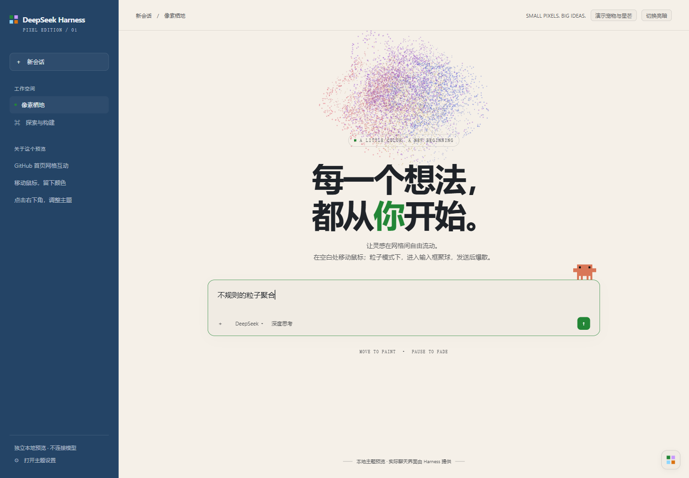
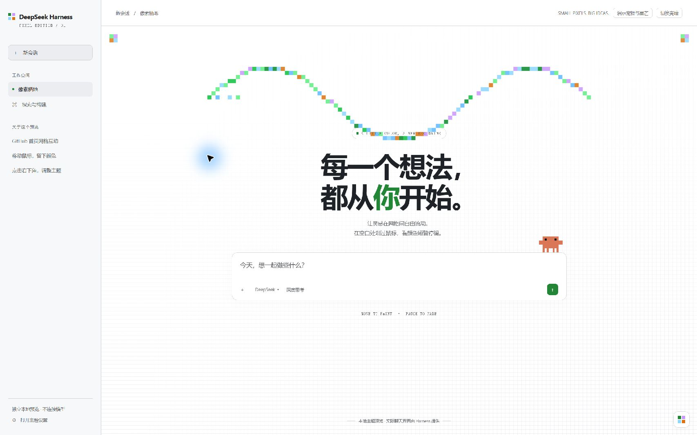
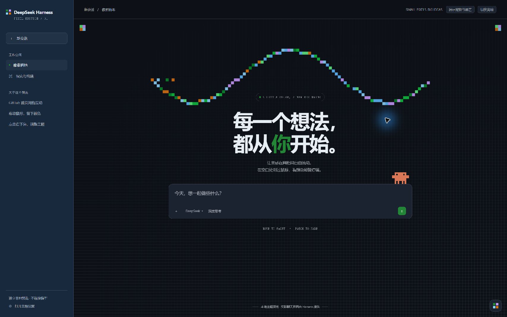
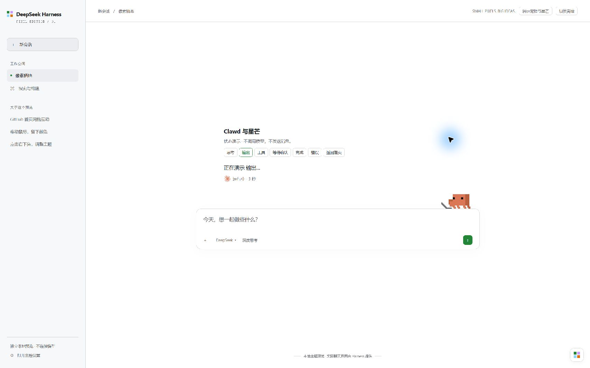
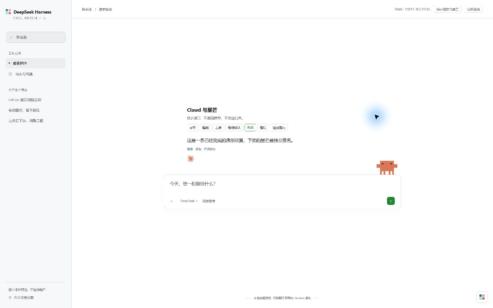
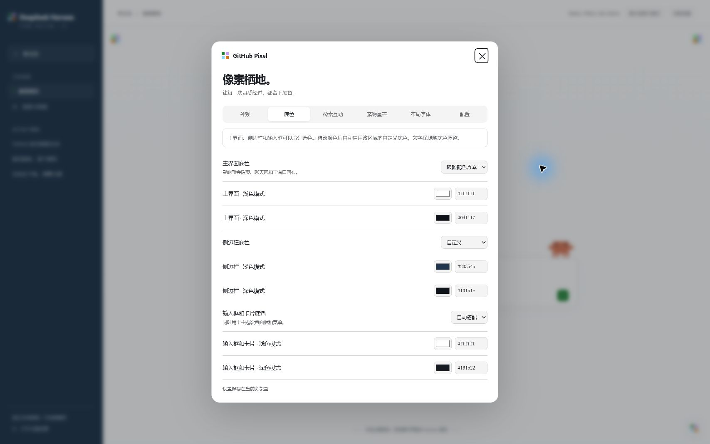

# GitHub Pixel · 像素栖地

DeepSeek Harness 互动主题：保留 GitHub 像素网格，新增可切换的 Antigravity 风格粒子场，支持独立底色、Clawd 桌面宠物与 Claude 风格星芒。

**普通用户推荐下载：[github-pixel-theme-1.4.1.zip](https://github.com/Caviar-bit/deepseek-harness-github-pixel-theme/releases/download/v1.4.1/github-pixel-theme-1.4.1.zip)。解压后安装，无需下载其他附件。**

[在线功能介绍与交互演示](https://caviar-bit.github.io/deepseek-harness-github-pixel-theme/) · [v1.4.1 发布页](https://github.com/Caviar-bit/deepseek-harness-github-pixel-theme/releases/tag/v1.4.1) · [历史版本（保留）](https://github.com/Caviar-bit/deepseek-harness-github-pixel-theme/releases) · [完整主题备用下载](github-pixel-theme-1.4.1.zip)

## 功能

- **两种互动背景即时切换**：GitHub 像素网格与 Antigravity 反重力粒子，各自保留参数和显示范围。
- **输入聚团**：鼠标进入输入框或开始编辑时，全场粒子约 1 秒聚成不规则立体粒子团，内部疏密错落，粒子错峰聚拢、独立流动，轮廓持续起伏并保留透视层次。
- **发送爆散**：点击发送后，粒子从当时的粒子团位置向外爆散，约 2.8 秒后平滑回归鼠标粒子场。默认延续到聊天页；残留输入焦点不会立刻重新聚球。
- 粒子优先由 WebGL2 在 GPU 上计算与批量绘制，无 WebGL2 时回退 Canvas 2D。数量、半径、强度、自然流速、大小、透明度及帧率可调；提供运行 FPS 显示。
- GitHub 像素网格支持鼠标彩色拖尾、点击扩散、角落装饰、消退和显示范围设置。
- 主界面、侧边栏、输入框和卡片分别改色；浅色、深色配置分别保存，粒子画布同步底色，避免黑底合成问题。
- GitHub、DeepSeek、森林、暮色及自定义配色；支持跟随系统或宿主外观。
- Clawd 桌面宠物、单一输出星芒或原生鲸鱼尾巴、已完成回复的独立星芒签名；保留状态文字和计时。
- 字体、字号、对话宽度、卡片圆角，JSON 配置导入与导出。
- 支持减少动态效果、后台暂停、上下文恢复和卸载清理。

### v1.4.1 不规则粒子团与爆散演示

以下为本地独立预览截图，不连接模型。彩球在实际运行中持续旋转与扭曲，发送后的爆散会自动回归鼠标互动。



### 画面演示

以下截图取自《GitHub像素主题-功能介绍.html》内的独立预览，展示 v1.2.3 的主题功能，不调用模型、不发送消息。点击图片可查看原图。

**想亲自体验鼠标拖尾、宠物动画和状态切换？[打开在线交互演示](https://caviar-bit.github.io/deepseek-harness-github-pixel-theme/#preview)。**

#### 浅色像素互动

细网格、四色像素拖尾与输入框上沿的 Clawd。图中用演示指针轨迹展示像素点亮效果；实际使用时由鼠标移动触发，停留后逐渐淡出。



#### 深色外观与独立底色

主界面、侧边栏、输入框与卡片可以分别选色。这组示例使用深色聊天区、蓝灰侧边栏和独立卡片底色，浅色、深色配置分别保存。



#### Clawd 与输出星芒

输出时，Clawd 切换到工作姿态；运行行显示 Claude 呼吸星芒，同时保留状态文字和计时。星芒模式下隐藏原生鲸鱼尾巴，避免图标叠加。



#### 回复末尾的星芒签名

回复完成后，在末尾显示独立的静态星芒。可选择仅最新回复、每条已完成回复或关闭，签名不会写入消息正文。



#### 底色设置面板

六组主题设置覆盖外观、底色、像素互动、宠物星芒、布局字体和配置管理。v1.2.3 中，输入完整色号即可即时改变侧边栏颜色，无需移开焦点。




## 安装与更新

1. 下载推荐的 `github-pixel-theme-1.4.1.zip` 并完整解压。
2. 关闭其他完整主题，避免样式叠加。
3. Windows 用户配置好 `dsh` 命令后，可运行“安装到桌面版.cmd”；也可在安装包目录运行：

```powershell
dsh plugin --profile desktop add "./dsh-github-pixel-theme-1.4.1.tgz"
```

4. **完全退出并重新打开 Harness。** 点击右下角四色按钮打开主题设置。
5. 选择“互动背景 → 背景互动效果 → Antigravity · 反重力粒子”，开启“输入聚团 · 发送爆散”。移动到输入框，输入内容后点击发送即可体验。

网页版将 `desktop` 换成对应 profile，例如 `web`，再重启服务并刷新页面。未发布到 npm，请使用本地 `.tgz` 安装。旧版配置兼容；GitHub 网格的显示范围保留原设置，Antigravity 默认显示在新会话与聊天页。

### 下载哪个文件？

| 文件 | 用途 |
| --- | --- |
| **`github-pixel-theme-1.4.1.zip`** | **推荐。** 安装包、安装脚本、独立预览、说明、源码和测试全部包含。 |
| `dsh-github-pixel-theme-1.4.1.tgz` | 熟悉 CLI、只需要安装插件时下载。 |
| `dsh-github-pixel-theme-source-1.4.1.zip` | 开发和修改主题时下载。 |
| GitHub 自动生成的 `Source code` | 仓库快照；普通安装请选上面的推荐 ZIP。 |

## 设置入口

| 分组 | 功能 |
| --- | --- |
| 外观 | 开关、亮暗模式、配色和强调色 |
| 底色 | 主界面、侧边栏、输入框及卡片的独立底色 |
| 互动背景 | 两种效果切换；各自范围与参数；输入聚团、发送爆散和实时 FPS |
| 宠物星芒 | Clawd、输出图标、回复签名及星芒颜色 |
| 布局字体 | 字体、字号、宽度和圆角 |
| 配置 | JSON 导入、导出和恢复默认 |

输入聚团可关闭；中文输入法确认、Shift+Enter 换行和“停止生成”不会触发爆散。Enter 仅在宿主接受发送并清空编辑器后触发。主题只观察界面事件，发送操作仍由 Harness 处理。

## 历史版本

已有的 Release、标签和下载附件均保留。需要回退时，到 [Releases](https://github.com/Caviar-bit/deepseek-harness-github-pixel-theme/releases) 下载对应版本的安装包。

- [v1.4.1](https://github.com/Caviar-bit/deepseek-harness-github-pixel-theme/releases/tag/v1.4.1)：双背景、GPU 粒子、输入聚团、发送爆散及黑底修正。
- [v1.4.0](https://github.com/Caviar-bit/deepseek-harness-github-pixel-theme/releases/tag/v1.4.0)：上一版规则彩球与发送爆散。
- [v1.2.3](https://github.com/Caviar-bit/deepseek-harness-github-pixel-theme/releases/tag/v1.2.3)：原像素主题版本，修复侧边栏调色。

## 源码与验证

推荐 ZIP 内的“源码”目录或独立源码 ZIP 均包含可编辑源码与全部测试。安装包已带构建产物，使用者无需编译。

```text
node build.mjs
node --test tests/*.test.mjs
```

构建无第三方依赖，需要 Node.js 22.18 或更新版本。通过 23 项自动测试；浏览器验证了聚球、持续旋转变形、点击与 Enter 发送、误触发排除、页面阶段切换、减少动态效果、GPU 上下文恢复、Canvas 回退及卸载清理。真实模型会话和不同实体手机尚未完整实测，实际 FPS 随设备、宿主和画布尺寸变化。

面向 DeepSeek Harness 0.2.x，最低声明版本 `0.2.1-rc.3`。宿主更新 DOM 或插件接口时可能需要适配。

## 素材与许可

代码采用 MIT 许可，见 `LICENSE`。主题设置结构参考 [Nwflower/dsh-claude-style](https://github.com/Nwflower/dsh-claude-style)，两种背景分别参考 [GitHub 首页](https://github.com/) 与 [Google Antigravity](https://antigravity.google/)，互动代码独立实现，不含上述网站源码。

Clawd、图集和星芒等素材不适用代码的 MIT 许可，权利归相应权利人；原始说明保留在 `ARTWORK-NOTICE.txt` 与源码素材目录。本项目为非官方个人主题，与 GitHub、Google、DeepSeek 或 Anthropic 无隶属关系。
